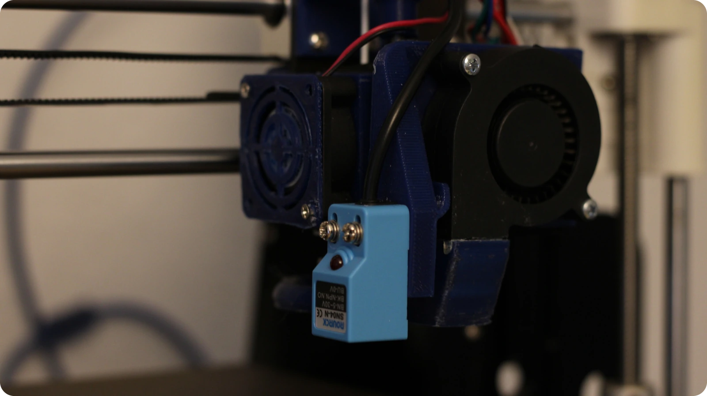

# Marlin 2.1.2.9 - Modded Anet A8



Custom Marlin firmware for a modified **Anet A8**, based on upstream
[MarlinFirmware/Marlin](https://github.com/MarlinFirmware/Marlin) **2.1.2.9**.

This is not a stock configuration. It carries a tuned machine profile plus a
few features the stock Anet A8 configuration does not enable, for example
**bilinear auto bed leveling with a fixed-mounted probe**.

| | |
|---|---|
| **Printer** | Anet A8 (acrylic i3 clone) |
| **Machine name** | `Anet A8` |
| **Marlin base** | 2.1.2.9 |
| **Board** | `BOARD_ANET_10`, Anet 1.0, ATmega1284P |
| **Build environment** | Arduino IDE with Marlin AVR Boards, board `Anet V1.0` |
| **Branch** | `custom` |

---

## Hardware assumptions

These settings describe one specific machine. If your Anet A8 differs in probe,
frame or extruder, **do not flash this as-is**.

- **Probe:** fixed-mounted inductive probe (no servo)
- **Bed:** full-size Anet A8 bed, with negative min positions so the nozzle can
  reach the whole surface
- **Endstops:** all min endstops, active-low (inverted logic)
- **Display:** stock Anet 20×4 LCD with five analog buttons (Zonestar-style)
- **Extruder:** calibrated E-steps, not the stock value

---

## Changes vs. stock Marlin 2.1.2.9

Everything below is a deliberate deviation from the default configuration.
Setting names are listed so you can find them. The values are in the config files.

### Machine identity and board

| Setting | Why it's changed |
|---|---|
| `MOTHERBOARD` | Set to the Anet 1.0 board |
| `BAUDRATE` | Matched to the Anet mainboard serial speed |
| `CUSTOM_MACHINE_NAME` | Shows `Anet A8` on the LCD info screen |
| `MACHINE_UUID` | Unique device ID instead of the all-zeros default |
| `STRING_CONFIG_H_AUTHOR` | Marks this as a custom build |

### Motion and calibration

| Setting | Why it's changed |
|---|---|
| `DEFAULT_AXIS_STEPS_PER_UNIT` | X/Y/Z from the stock mechanics, E calibrated for this extruder |
| `DEFAULT_MAX_FEEDRATE` | Raised X/Y speed, realistic Z/E limits |
| `DEFAULT_MAX_ACCELERATION` | Tuned for the acrylic frame |
| `DEFAULT_ACCELERATION` | Print acceleration lowered for frame rigidity |
| `DEFAULT_RETRACT_ACCELERATION` | Retract acceleration tuned |
| `DEFAULT_TRAVEL_ACCELERATION` | Travel acceleration tuned |
| `DEFAULT_XJERK` / `DEFAULT_YJERK` | Higher jerk for smoother corners |
| `INVERT_Y_DIR` / `INVERT_Z_DIR` | Corrected motor directions |
| `X_MIN_ENDSTOP_INVERTING` | Active-low endstops |
| `Y_MIN_ENDSTOP_INVERTING` | Active-low endstops |
| `Z_MIN_ENDSTOP_INVERTING` | Active-low endstops |
| `Z_MIN_PROBE_ENDSTOP_INVERTING` | Active-low probe |

### Hotend PID

| Setting | Why it's changed |
|---|---|
| `DEFAULT_KP` / `DEFAULT_KI` / `DEFAULT_KD` | Calibrated for the stock Anet A8 hotend |

### Auto bed leveling

| Setting | Why it's changed |
|---|---|
| `FIX_MOUNTED_PROBE` | Inductive probe, no servo |
| `NOZZLE_TO_PROBE_OFFSET` | Measured probe position relative to the nozzle |
| `Z_MIN_PROBE_REPEATABILITY_TEST` | Enables `M48` for probe testing |
| `AUTO_BED_LEVELING_BILINEAR` | Grid-based leveling |
| `RESTORE_LEVELING_AFTER_G28` | Keeps leveling active after homing |
| `Z_SAFE_HOMING` | Homes Z at bed center, away from the probe |
| `X_BED_SIZE` / `Y_BED_SIZE` | Full printable area |
| `X_MIN_POS` / `Y_MIN_POS` | Negative travel so the nozzle reaches the whole bed |

### Skew correction

The acrylic frame is not perfectly square, so skew correction is enabled. The
correction values were not derived from the frame dimensions. They were found by
printing dedicated skew calibration test prints, measuring the resulting parts,
and iterating until the printed geometry came out square. The frame itself was
never measured for this.

| Setting | Why it's changed |
|---|---|
| `SKEW_CORRECTION` | Compensates for the non-square frame |
| `XY_DIAG_AC` / `XY_DIAG_BD` / `XY_SIDE_AD` | Derived from test prints and part measurements, not from the frame |

> **Note:** These values are specific to this printer. Re-run the test print
> calibration before reusing them on another machine, or the correction could make
> things worse.

### Display and UI

| Setting | Why it's changed |
|---|---|
| `ZONESTAR_LCD` | Anet 20×4 LCD with 5 analog buttons |
| `DISPLAY_CHARSET_HD44780` | Correct character set for this LCD |
| `SOFT_ENDSTOPS_MENU_ITEM` | Toggle soft endstops from the LCD |

### Storage and fans

| Setting | Why it's changed |
|---|---|
| `EEPROM_SETTINGS` | `M500`/`M501` persist calibration across flashes |
| `FAN_KICKSTART_TIME` / `FAN_KICKSTART_POWER` | Fan reliably starts from standstill |

---

## Building

The board is an ATmega1284P, which the stock Arduino IDE does not know about, so
a third-party board package is needed. This build uses **Marlin AVR Boards**,
installed into the Arduino sketchbook `hardware` folder. The package is not part
of this repository. It comes from
[SkyNet3D/anet-board](https://github.com/SkyNet3D/anet-board).

### One-time setup

1. Install the [Arduino IDE](https://www.arduino.cc/en/software) (1.8.x or 2.x).
2. Find your sketchbook location under **File, Preferences**. The default on
   Linux is `~/Arduino`.
3. Download [SkyNet3D/anet-board](https://github.com/SkyNet3D/anet-board) and
   copy its `anet` folder into the `hardware` folder of the sketchbook, so the
   layout looks like this:

   ```
   ~/Arduino/hardware/anet/avr/
   ├── boards.txt
   ├── platform.txt
   ├── bootloaders/
   └── variants/
   ```

4. Restart the Arduino IDE. **Tools, Board** now lists **Marlin AVR Boards** with
   the entries `Anet V1.0` and `Anet V1.0 (Optiboot)`.

### Uploading

1. Open `Marlin/Marlin.ino` in the Arduino IDE.
2. Select **Tools, Board, Marlin AVR Boards, Anet V1.0**.
3. Select the serial port of the printer under **Tools, Port**.
4. Click **Upload**.

### After flashing

Because `EEPROM_SETTINGS` is enabled, previously stored values can override the
new defaults. After flashing a changed configuration, reset the EEPROM:

```
M502
M500
```

`M502` restores the firmware defaults, `M500` saves them to EEPROM. Then re-run
your calibration (`M48` for the probe) and `M500` again.

---

## Upstream Marlin

This repository is a fork. For general Marlin documentation, configuration help,
and support, see:

- [Marlin Home Page](https://marlinfw.org/)
- [Marlin Documentation](https://marlinfw.org/docs/basics/introduction.html)
- [Marlin Discord](https://discord.com/servers/marlin-firmware-461605380783472640)
- [MarlinFirmware/Configurations](https://github.com/MarlinFirmware/Configurations), stock configurations

Marlin is published under the [GPL-3.0 license](LICENSE). This fork keeps the same
license. The full Marlin source is included here as required.
